# Dossier de React Native con Expo y Android Studio

**Programación Multimedia y Dispositivos Móviles · 2.º DAM**

Este es el material de trabajo del bloque de **React Native con Expo, TypeScript y Android Studio**. Avanzad en el orden de los contenidos y realizad las prácticas propuestas, incluida la **práctica 9.1**. Los ejemplos y las explicaciones de este documento son los que debéis seguir para desarrollar la aplicación.

**Norma de trabajo:** todas las prácticas se realizan sobre **un solo proyecto Expo**. No eliminéis las ya realizadas. A partir del apartado «Estructura de carpetas», el índice principal permitirá abrir cada práctica; para las que requieran varios recorridos de navegación se crearán subcarpetas independientes. La creación del proyecto y los archivos de cada ejemplo se explican de forma progresiva en los apartados correspondientes.

**Figuras y ejemplos:** las imágenes incluidas en este dossier ilustran el resultado visual o determinados fragmentos de código. Cuando una figura muestre una configuración antigua, utilizad siempre los comandos y ejemplos de Expo escritos en el texto de este material. Las imágenes están guardadas en la carpeta `imagenes/` del propio repositorio.

**Documentación del trabajo:** vuestro repositorio GitHub incluirá un `README.md` con un apartado por práctica, explicación del procedimiento, capturas propias de la aplicación, problemas encontrados y estado de cada ejercicio. Realizad los commits y las entregas parciales en las fechas indicadas en el Aula Virtual.

## Índice

1. Introducción
2. Instalaciones necesarias y opcionales
3. Primeros pasos
4. Componentes básicos y layout
5. Estructura de carpetas
6. Formularios, Switch, Alert/Prompt
7. Listas
8. Iconos
9. Navegación en React Native (Stack, Context, Drawer y Tabs)
10. Accediendo a APIs
11. Permisos
12. Async Storage y WebView
13. Bases de datos: SQLite y relaciones
14. Transacciones

---


# Introducción

**React Native** es un entorno de desarrollo basado en React que permite construir aplicaciones móviles utilizando JavaScript o TypeScript. No escribimos HTML: las interfaces se construyen con componentes como `View`, `Text`, `Image` o `TextInput`, que React Native representa mediante elementos de la interfaz nativa de Android o iOS.

**Expo** es un conjunto de herramientas y bibliotecas que facilita crear, ejecutar y mantener aplicaciones React Native. Lo utilizaremos para gestionar el proyecto, arrancar el servidor de desarrollo, abrir la aplicación en el emulador de Android y acceder a funcionalidades del dispositivo. **Expo no sustituye a React Native**: trabajaremos con los mismos componentes, estados, propiedades y estilos de React.

En el dossier usaremos **TypeScript (`.tsx`)** para comprobar los tipos de datos y **Android Studio como emulador**, aunque Expo también permite desarrollar para iOS y utilizar un dispositivo físico compatible. La mayor parte de las prácticas utilizará Expo Go; en alguna integración nativa podría ser necesario un *development build*, circunstancia que se explicará cuando corresponda.

**Objetivo general:** completar todas las prácticas dentro de **una sola aplicación Expo**. Cada resultado permanecerá accesible desde un índice de ejercicios; no borraremos ejercicios anteriores para empezar los siguientes.

---


## Instalaciones necesarias y opcionales

Preparad las siguientes herramientas:

1. **Node.js en versión LTS**, que incluye npm. Comprobadlo con `node --version` y `npm --version`.
2. **Visual Studio Code**, para editar los archivos `.tsx`, `.ts` y `.md`.
3. **Android Studio**, con Android SDK, Android SDK Platform-Tools y Android Emulator. Desde **Device Manager**, cread un dispositivo virtual con una imagen Android compatible e iniciadlo.
4. **Git y una cuenta de GitHub**, para conservar el desarrollo de las prácticas y documentarlo.

No necesitáis instalar React Native CLI globalmente ni crear carpetas `android/` e `ios/` a mano. Con Expo instalaremos las bibliotecas que precisen integración nativa mediante `npx expo install`, para elegir versiones compatibles con el SDK del proyecto.

**Comprobad el emulador:** después de iniciarlo desde Android Studio, abrid una terminal y ejecutad `adb devices`. Debe aparecer un dispositivo con estado `device`. Si `adb` no se reconoce, revisad la ruta de `platform-tools` y las variables de entorno en la [guía oficial de Expo](https://docs.expo.dev/get-started/set-up-your-environment/). No copiéis a ciegas rutas de Android SDK de otro sistema operativo.

Las extensiones de VS Code para React/TypeScript y los iconos de archivos son opcionales; ninguna es indispensable para ejecutar la aplicación.

---


## Primeros pasos

### Crear y ejecutar un proyecto Expo

En la terminal, desde la carpeta donde guardéis los proyectos, ejecutad:

```bash
npx create-expo-app@latest dossier-react-native --template default
cd dossier-react-native
code .
npx expo start
```

El creador de proyectos instalará Expo, TypeScript y la estructura de rutas de Expo Router. Si os pide confirmar la instalación, aceptad. Con el emulador de Android ya iniciado, pulsad **`a`** en la terminal del servidor de Expo. Si la aplicación no se abre, comprobad el dispositivo con `adb devices` y volved a arrancar el servidor.

> Las plantillas y su estructura evolucionan. Si el proyecto inicial incluye pantallas demostrativas, seguid la guía de limpieza de la plantilla que indique vuestra versión de Expo; conservad `src/app/_layout.tsx` y `src/app/index.tsx` (o `app/` cuando la plantilla no use `src/`). A partir de aquí, todos los ejemplos del dossier consideran `src/app/`.

**Archivos básicos:** `package.json` enumera scripts y dependencias; `app.json` contiene la configuración de Expo; `tsconfig.json` configura TypeScript; `assets/` almacena imágenes; `src/app/` contiene las rutas de navegación.

### Práctica 1. Hola mundo

En `src/app/index.tsx` cread una pantalla que muestre el mensaje «¡Hola mundo! Soy [vuestro nombre]». Utilizad un `View` y un `Text`; aplicad fondo rosa, `flex: 1`, `justifyContent: 'center'` y `alignItems: 'center'`.

```tsx
import { StyleSheet, Text, View } from 'react-native';

export default function Index() {
  return (
    <View style={styles.pantalla}>
      <Text>¡Hola mundo! Soy ...</Text>
    </View>
  );
}

const styles = StyleSheet.create({
  pantalla: {
    alignItems: 'center',
    backgroundColor: 'lightpink',
    flex: 1,
    justifyContent: 'center',
  },
});
```

Comprobad que aparece en el emulador. **Guardad este primer resultado**: en la práctica 3 organizaremos las pantallas para no perder las versiones anteriores.

---


## Componentes básicos y layout

### `View`, `Text` y `Button`

`View` es un contenedor visual; equivale a una caja capaz de agrupar otros componentes. `Text` sirve para mostrar texto: no podemos escribir cadenas directamente dentro de un `View` sin envolverlas en `Text`. `Button` presenta un botón nativo con propiedades básicas: `title`, `onPress`, `color` y `accessibilityLabel`.

Estos componentes se importan desde `react-native`, **también al usar Expo**. Un estado creado con `useState` permite actualizar la pantalla cuando cambia su valor:

```tsx
import { useState } from 'react';
import { Button, StyleSheet, Text, View } from 'react-native';

export default function ContadorScreen() {
  const [contador, setContador] = useState(0);
  return (
    <View style={styles.caja}>
      <Text>Contador: {contador}</Text>
      <Button title="Incrementar" onPress={() => setContador(n => n + 1)} />
    </View>
  );
}
const styles = StyleSheet.create({
  caja: { alignItems: 'center', borderWidth: 2, padding: 20 },
});
```

Cuando se pulsa el botón, `setContador` actualiza el estado y React vuelve a representar el componente. No es necesario modificar manualmente el texto de la pantalla.

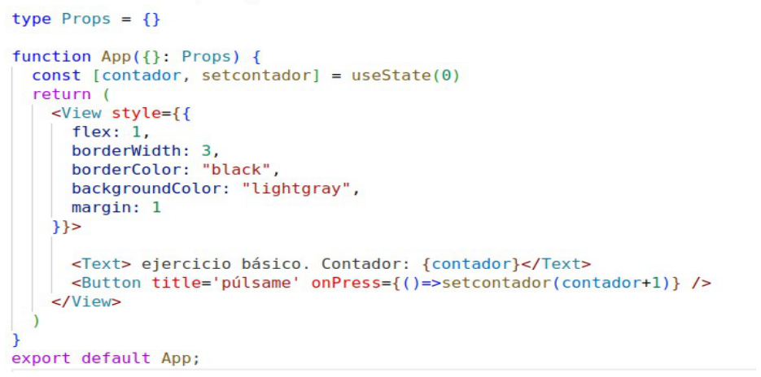

---


### Práctica 2. Contador con dos botones

Partiendo del ejemplo anterior, cambiad el color del borde y del fondo, redondead las esquinas con `borderRadius` e incorporad otro botón que decremente el contador. Mostrad el valor en un `Text` y comprobad el resultado en Android Studio.

**Cómo resolverla:** utilizad el mismo estado `contador` y dos funciones `onPress`, una con `setContador(n => n + 1)` y otra con `setContador(n => n - 1)`. Personalizad el contenedor mediante `StyleSheet.create()`; el `Button` nativo no admite la misma personalización que un `View`.

### Separar pantallas, componentes y estilos

Hasta ahora habéis escrito todo en un único archivo. En las siguientes prácticas separaremos los componentes reutilizables (`src/components/`) de las pantallas completas (`src/screens/`). Las pantallas que se abren desde Expo Router necesitan, además, un archivo de ruta dentro de `src/app/`.

`StyleSheet.create()` permite guardar estilos reutilizables y evita llenar el JSX de objetos repetidos:

```tsx
const styles = StyleSheet.create({
  contenedorCircular: {
    backgroundColor: 'rgba(191, 186, 221, 0.54)',
    borderRadius: 100,
    padding: 20,
  },
});
// En el JSX: <View style={styles.contenedorCircular}>...</View>
```

Podéis instalar extensiones de fragmentos de código (*snippets*), pero los atajos concretos dependen de la extensión: no son comandos de Expo.

---


### Práctica 3. `InicioScreen` y estilos separados

Cread `src/screens/InicioScreen.tsx` para colocar el contador de la práctica 2. En `src/app/index.tsx`, importad y mostrad `<InicioScreen />`. Los estilos deberán declararse mediante `StyleSheet.create()`.

**Para conservar las prácticas:** en este momento podéis guardar el «Hola mundo» como `src/screens/HolaMundoScreen.tsx`. Después crearemos un índice de rutas para abrir cada pantalla por separado; no eliminéis el código del primer ejercicio. `src/screens/` contiene la implementación y `src/app/` actuará como enlace a ella cuando configuremos las rutas.

```tsx
// src/app/index.tsx (hasta crear el menú general)
import InicioScreen from '../screens/InicioScreen';
export default function Index() {
  return <InicioScreen />;
}
```

Revisad que ambos archivos funcionen, que no haya errores de importación y que el contador conserve su comportamiento.

---


### Layout con Flexbox

React Native emplea Flexbox para distribuir componentes. Frente al CSS del navegador, los contenedores se organizan **en columna por defecto** (`flexDirection: 'column'`) y no necesitan `display: 'flex'`. Las unidades numéricas de `width`, `height`, `margin` o `padding` se expresan normalmente como unidades lógicas, sin añadir `px`.

Con `flex: 1` un contenedor ocupa el espacio libre. `flexDirection: 'row'` coloca los hijos en horizontal y `flexDirection: 'column'` los coloca en vertical.

```tsx
// src/components/Caja.tsx
import { StyleSheet, Text, View } from 'react-native';

type Props = { nombre: string; bg?: string };
export default function Caja({ nombre, bg = 'green' }: Props) {
  return (
    <View style={[styles.caja, { backgroundColor: bg }]}>
      <Text>{nombre}</Text>
    </View>
  );
}
const styles = StyleSheet.create({
  caja: { height: 100, width: 100, justifyContent: 'center', alignItems: 'center' },
});
```

La sintaxis `style={[styles.caja, { backgroundColor: bg }]}` combina un estilo base y un valor personalizado, también se puede utilizar la extensión de objetos con `...styles.caja`.

### Práctica 4. Tres cajas

Cread una pantalla `PrincipalScreen` con el texto «Contenedor Principal» y un `View` para el escenario. Dentro colocad tres componentes `Caja` de 100 × 100 y enviadles colores diferentes mediante propiedades. El escenario debe tener `flex: 1`.

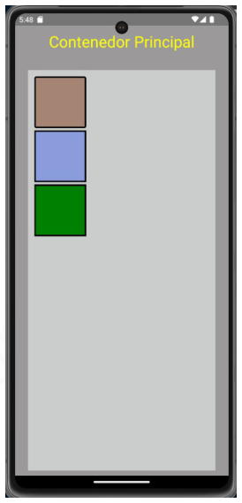

---


### Reparto del espacio con `flex`

`flex` controla cómo se reparte el espacio libre entre elementos hermanos. Dos hijos con `flex: 1` comparten ese espacio; si uno tiene `flex: 2`, recibe el doble de la parte asignada al que tiene `flex: 1`, siempre que las restantes restricciones de tamaño lo permitan.

**Atención:** si una caja tiene `height: 100`, el efecto de `flex` puede verse condicionado por esa altura. Para observar claramente el reparto en la siguiente práctica, podéis usar una variante de la caja sin altura fija.

### Práctica 5. Modificar `flex` dinámicamente

Añadid a cada caja dos botones: uno incrementará su valor de `flex` y otro lo disminuirá. Mostrad el valor actual de cada caja y comprobad cómo se reorganiza el espacio. Guardad los valores en estados independientes y evitad valores negativos cuando no tengan sentido para vuestro diseño.

```tsx
const [valorFlex, setValorFlex] = useState(0);
// Aplicad { flex: valorFlex } al contenedor de la caja.
// Botones: setValorFlex(n => n + 1) y setValorFlex(n => Math.max(0, n - 1)).
```

El resultado debe seguir siendo consultable cuando paséis a los siguientes ejercicios.

---


### `TouchableOpacity` y `TouchableHighlight`

Los botones nativos permiten poca personalización. React Native incluye componentes que reaccionan al tacto y pueden envolver una interfaz personalizada. `TouchableOpacity` reduce la opacidad al pulsar; `TouchableHighlight` muestra un resaltado. Ambos utilizan `onPress`.

```tsx
import { Alert, Text, TouchableHighlight, TouchableOpacity } from 'react-native';

<TouchableHighlight onPress={() => Alert.alert('Pulsado')} underlayColor="#ddd">
  <Text>Botón destacado</Text>
</TouchableHighlight>

<TouchableOpacity onPress={() => Alert.alert('Pulsado')}>
  <Text>Botón con opacidad</Text>
</TouchableOpacity>
```

En aplicaciones actuales también puede utilizarse `Pressable`, pero para observar las diferencias entre los componentes táctiles trabajaremos aquí con los dos componentes anteriores.

### Práctica 6. Sustituir los botones

Sustituid los botones de la práctica 5: para `flex + 1`, utilizad un `TouchableHighlight` que muestre una alerta y aumente el valor; para `flex - 1`, utilizad `TouchableOpacity` y reducid el valor. Personalizad el aspecto de ambos.

---


### Propiedades de estilo recibidas por un componente

Para personalizar una caja desde la pantalla que la utiliza, declarad una propiedad `style` del tipo `StyleProp<ViewStyle>` y combinad el estilo por defecto con el recibido.

```tsx
import type { StyleProp, ViewStyle } from 'react-native';

type Props = { nombre: string; style?: StyleProp<ViewStyle> };
// En el componente:
// <View style={[styles.porDefecto, style]}><Text>{nombre}</Text></View>
// Al utilizarlo:
// <Caja nombre="Caja B" style={{ borderRadius: 20, borderWidth: 7 }} />
```

El segundo estilo sobrescribe las propiedades repetidas del primero. De esta manera podéis reutilizar el mismo componente sin duplicar su código.

### Práctica 7. Nombre y estilos personalizados

Adaptad la pantalla para que cada caja muestre su nombre (Caja A, B y C) y acepte estilos enviados mediante propiedades. Al menos una caja debe tener esquinas redondeadas y un borde diferente, como se describe en la actividad.

---


### `flexWrap` y `flexDirection`

`flexWrap: 'wrap'` permite que los hijos pasen a la siguiente fila o columna cuando ya no caben. El valor por defecto es `'nowrap'`. `flexDirection` puede valer `'row'`, `'column'`, `'row-reverse'` o `'column-reverse'`.

```tsx
<View style={{ flex: 1, flexDirection: 'row', flexWrap: 'wrap', gap: 8 }}>
  {colores.map((color, index) => (
    <View key={index} style={{ width: 60, height: 60, borderRadius: 30, backgroundColor: color }} />
  ))}
</View>
```

En React es necesario incluir una clave estable (`key`) para cada elemento creado mediante `map`.

### Práctica 8. Círculos dinámicos

Comenzad con un escenario vacío. Un botón añadirá un círculo de color variable; otros dos alternarán `wrap/nowrap` y `row/column`. Mostrad los controles como botones personalizados (`TouchableOpacity`). Evitad que los valores RGB superen 255; podéis limitar el cálculo con `Math.min(255, valor)`.

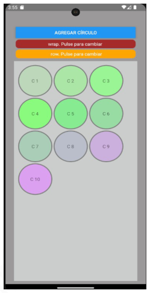

---


### `Image`, `TextInput`, `justifyContent` y `alignItems`

`justifyContent` distribuye los elementos a lo largo del eje principal (el que determina `flexDirection`); `alignItems` los alinea sobre el eje transversal. Por ejemplo, con dirección `column`, `justifyContent: 'space-around'` reparte el espacio vertical y `alignItems: 'center'` centra horizontalmente los hijos.

`TextInput` permite introducir texto mediante las propiedades `value`, `placeholder`, `onChangeText` y `style`. En un campo controlado, el valor procede de un estado:

```tsx
const [alineacion, setAlineacion] = useState('center');
<TextInput
  placeholder="center, space-around..."
  value={alineacion}
  onChangeText={setAlineacion}
/>
```

Antes de aplicar lo escrito como valor de `justifyContent`, comprobad que coincide con uno de los valores admitidos. En TypeScript es recomendable definir un tipo unión con esos valores, para evitar errores al asignarlo a estilos.

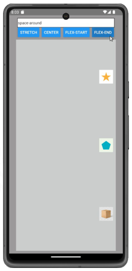

---


### Contenedores anidados e imágenes

Cada contenedor puede utilizar su propia dirección Flexbox. Así, un `View` con dirección `column` puede contener una fila horizontal de botones dentro de un `View` con `flexDirection: 'row'`.

`Image` representa imágenes locales o remotas. Una imagen por URL se carga indicando `source={{ uri: 'https://...' }}`; una imagen del proyecto utiliza `require` con una ruta estática.

```tsx
import { Image } from 'react-native';
<Image source={{ uri: 'https://reactnative.dev/img/tiny_logo.png' }}
       style={{ width: 80, height: 80 }} />
<Image source={require('../../assets/images/icon.png')}
       style={{ width: 80, height: 80 }} />
```

**Nota:** comprobad la ruta del ejemplo local con los nombres reales de los archivos de vuestro proyecto. Algunas URL de imágenes externas pueden caducar; utilizad imágenes propias o enlaces estables.

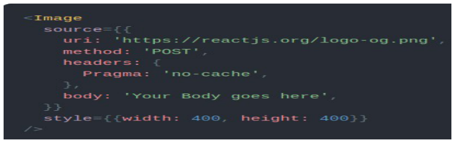

---


### Imágenes locales y remotas

Para imágenes remotas empleamos un objeto con `uri`. Para archivos locales agrupados en el proyecto utilizamos `require('ruta-estática')`. No es válido construir dinámicamente la ruta de `require` mediante una variable: el empaquetador debe conocer los archivos durante la compilación.

### Práctica 9. Distribución, alineación e imágenes

Cread una pantalla con estos elementos: un campo de texto que permita elegir un valor válido de `justifyContent`, botones para modificar `alignItems` y tres imágenes. **Al menos una de las imágenes deberá cargarse desde los archivos del proyecto mediante `require`**. Las otras pueden ser remotas o locales. Utilizad `flexWrap: 'nowrap'` para observar el efecto de las alineaciones respecto al contenedor.

Indicad en pantalla cuál es la alineación activa, de forma que pueda comprobarse el funcionamiento.

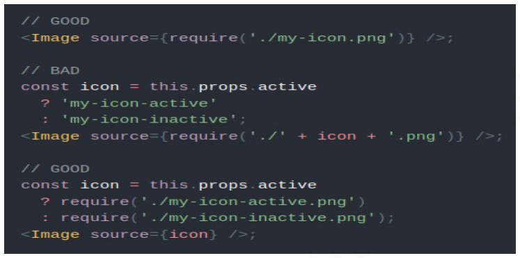

---


### Seleccionar imágenes locales desde una colección

Para elegir una imagen local de forma dinámica, definid previamente una lista cuyos valores contengan llamadas estáticas a `require`:

```tsx
const imagenes = [
  { nombre: 'estrella', source: require('../../assets/estrella.png') },
  { nombre: 'gato', source: require('../../assets/gato.png') },
];
const elegida = imagenes[indice];
// <Image source={elegida.source} style={{width:120,height:120}} />
```

Los archivos `estrella.png` y `gato.png` deben existir antes de ejecutar el ejemplo. La posición seleccionada puede almacenarse en un estado.

### Práctica 9.1. Imagen aleatoria

Partiendo de una colección de imágenes locales, añadid un botón que elija aleatoriamente una imagen y la muestre. Utilizad `Math.floor(Math.random() * imagenes.length)` y actualizad el índice mediante `useState`.

### Áreas seguras de pantalla

Para evitar que el contenido quede debajo de la barra de estado o de las áreas reservadas de Android, utilizad `SafeAreaView` importado desde **`react-native-safe-area-context`**. En proyectos con Expo Router, podéis aplicarlo a pantallas que lo necesiten o gestionar las zonas seguras desde un contenedor compartido. No utilizaremos la antigua importación de `SafeAreaView` desde `react-native`.

---


### Más propiedades de layout y cálculo

`gap`, `rowGap` y `columnGap` permiten espaciar elementos; `alignContent` distribuye líneas cuando usamos `flexWrap: 'wrap'`; `position` admite `'relative'` y `'absolute'`. El componente `Text` dispone de `adjustsFontSizeToFit` y `numberOfLines` para adaptar un resultado largo al ancho disponible.

### Práctica 10. Calculadora

Reproducid la calculadora de la figura: pantalla de resultado y filas de teclas numéricas y de operaciones. Construid los botones como componentes reutilizables con `TouchableOpacity`. Utilizad Flexbox para las filas y mantened el resultado en un estado. Deben funcionar las operaciones que decidáis implementar según el diseño de referencia; evitad evaluar directamente cadenas arbitrarias con `eval`.

**Organización recomendada:** `CalculadoraScreen.tsx` contendrá la interfaz, y un componente `TeclaCalculadora.tsx` definirá el aspecto y la interacción de cada tecla. Conservad la práctica 10: la práctica siguiente extraerá su lógica a un hook, pero no debe eliminar su resultado.

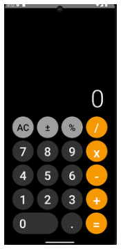

---


## Estructura de carpetas

Después de las primeras prácticas vamos a organizar de manera más completa **el único proyecto Expo del dossier**. No hace falta crear un proyecto nuevo. Tomad esta estructura como referencia y añadid carpetas cuando realmente se utilicen:

```text
src/
├── app/
│   ├── _layout.tsx
│   ├── index.tsx                # Índice general de prácticas
│   ├── practica01.tsx
│   ├── practica02.tsx
│   ├── ...
│   └── practica40.tsx
├── screens/                    # Pantallas con la implementación
├── components/                 # Componentes reutilizables
├── hooks/                      # Hooks personalizados
├── context/                    # Estados compartidos
├── api/                        # Peticiones HTTP
├── db/                         # SQLite y consultas
├── navigation/                 # Ayudas de navegación, si se necesitan
└── theme/                      # Estilos, colores y constantes
assets/                          # Imágenes y recursos
```

Los archivos dentro de `src/app/` son **rutas de Expo Router**. Podéis exportar desde ellos una pantalla definida en `src/screens/`, por ejemplo: `export { default } from '../screens/InicioScreen';`. Para ejercicios con varias pantallas (Stack, Drawer, Tabs) crearemos una **carpeta de rutas exclusiva para ese ejercicio**, con su propio `_layout.tsx`.

Para que no desaparezcan las prácticas 1–10, cread ahora las rutas necesarias y transformad `src/app/index.tsx` en un **índice de ejercicios**. El ejemplo siguiente puede ampliarse conforme avancéis:

```tsx
import { Link } from 'expo-router';
import { ScrollView, Text } from 'react-native';
export default function Index() {
  return (
    <ScrollView contentContainerStyle={{ padding: 20, gap: 16 }}>
      <Text>Prácticas de React Native con Expo</Text>
      <Link href="/practica01">Práctica 1</Link>
      <Link href="/practica02">Práctica 2</Link>
    </ScrollView>
  );
}
```

Cada ruta deberá apuntar a un archivo real: por ejemplo, `src/app/practica01.tsx` exporta `HolaMundoScreen`. Ampliad el índice según vayáis creando prácticas. **No situéis componentes auxiliares sueltos dentro de `src/app/`**, porque Expo Router puede interpretarlos como rutas.

### Práctica 11. Hook personalizado para la calculadora

Extraed de la calculadora las variables de estado y las funciones que no forman parte del JSX a un hook `src/hooks/useCalculadora.ts`. La pantalla importará el hook y utilizará los valores y funciones que este devuelva. Comprobad que la calculadora sigue funcionando.

---


## Formularios, Switch, Alert/Prompt

### Alertas

`Alert.alert()` muestra un diálogo nativo para informar al usuario o solicitar una confirmación. Acepta un título, un mensaje y botones con funciones asociadas:

```tsx
import { Alert } from 'react-native';
Alert.alert('Cambiar color', '¿Aplicar el nuevo fondo?', [
  { text: 'Cancelar', style: 'cancel' },
  { text: 'Aceptar', onPress: () => setFondo(colorPropuesto) },
]);
```

El cambio se produce al pulsar «Aceptar»; si se cancela, el estado no se modifica.

### Práctica 12. Color aleatorio con confirmación

Cread una pantalla con un botón «Cambiar de color». Al pulsarlo elegid aleatoriamente un color de una lista y mostrad una alerta indicando cuál se propone. Si se acepta, cambiad el fondo; si se cancela, conservad el anterior.

Para solicitar texto dentro de un diálogo en Android, crearemos un componente compatible con Expo en lugar de depender de un paquete nativo de terceros.

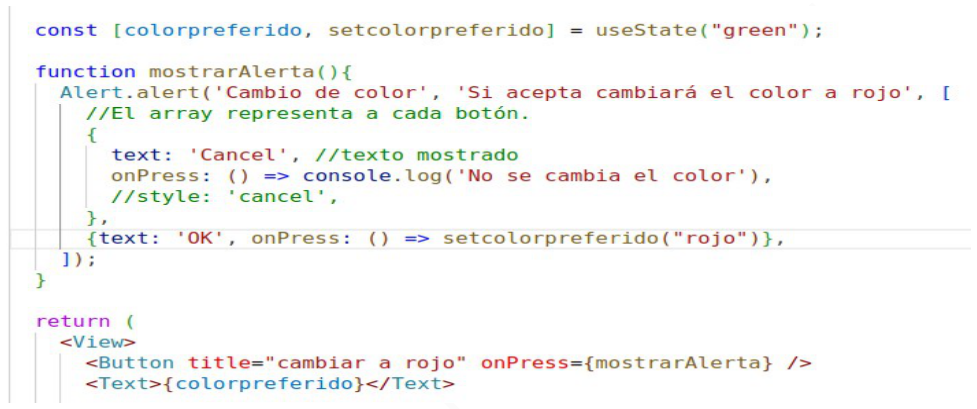

---


### Solicitar texto mediante `Modal` y `TextInput`

`Alert.prompt()` no se utiliza del mismo modo en Android e iOS. Para pedir un valor de texto en ambos sistemas, cread un componente con `Modal`, un `TextInput` y dos controles para cancelar o aceptar.

```tsx
const [visible, setVisible] = useState(false);
const [colorEscrito, setColorEscrito] = useState('lightblue');
// ...
<Modal visible={visible} transparent animationType="fade" onRequestClose={() => setVisible(false)}>
  <View style={{ flex: 1, justifyContent: 'center', padding: 24, backgroundColor: '#0008' }}>
    <View style={{ padding: 20, backgroundColor: 'white', borderRadius: 12 }}>
      <TextInput value={colorEscrito} onChangeText={setColorEscrito} placeholder="Color CSS" />
      <Button title="Cancelar" onPress={() => setVisible(false)} />
      <Button title="Aceptar" onPress={() => { setFondo(colorEscrito); setVisible(false); }} />
    </View>
  </View>
</Modal>
```

> Este ejemplo enseña la estructura del diálogo; antes de utilizar el color escrito, comprobad que sea un valor válido. El estado `fondo` se declara en la pantalla como en la práctica 12.

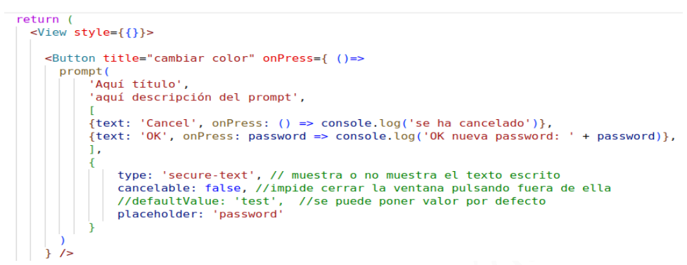

### Práctica 13. Introducir el color

Repetid la práctica 12, pero permitiendo escribir el color mediante el diálogo. Al aceptar un valor válido, cambiad el fondo de la pantalla. Si se cancela, no cambiéis nada.

### `Switch`

`Switch` es un control booleano. Se conecta a `value` y `onValueChange` y permite personalizar el color del indicador con `thumbColor`.

```tsx
<Switch value={activo} onValueChange={setActivo} thumbColor={activo ? 'orange' : 'brown'} />
```

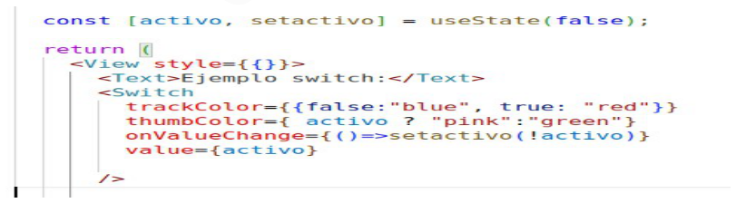

### Práctica 14. Borde activado por Switch

Reproducid el control de referencia: indicador marrón cuando está desactivado y naranja cuando está activado. Al activarlo, mostrad un borde rojo alrededor de la pantalla; al desactivarlo, quitad el borde.

---


### Formularios

En React Native no utilizamos la etiqueta HTML `<form>`. Los componentes `TextInput`, `Switch` y `Button` permiten crear formularios controlados con `useState`.

Para el formulario de persona trabajaremos con los campos `nombre`, `edad`, `casado` y `jubilado`:

```tsx
type DatosPersona = {
  nombre: string;
  edad: string; // TextInput siempre devuelve texto
  casado: boolean;
  jubilado: boolean;
};
const [datos, setDatos] = useState<DatosPersona>({
  nombre: '', edad: '', casado: false, jubilado: false,
});
```

Mantendremos inicialmente la edad como texto y la convertiremos a número al validarla (`Number(datos.edad)`); así evitamos errores al borrar o editar los caracteres del campo.

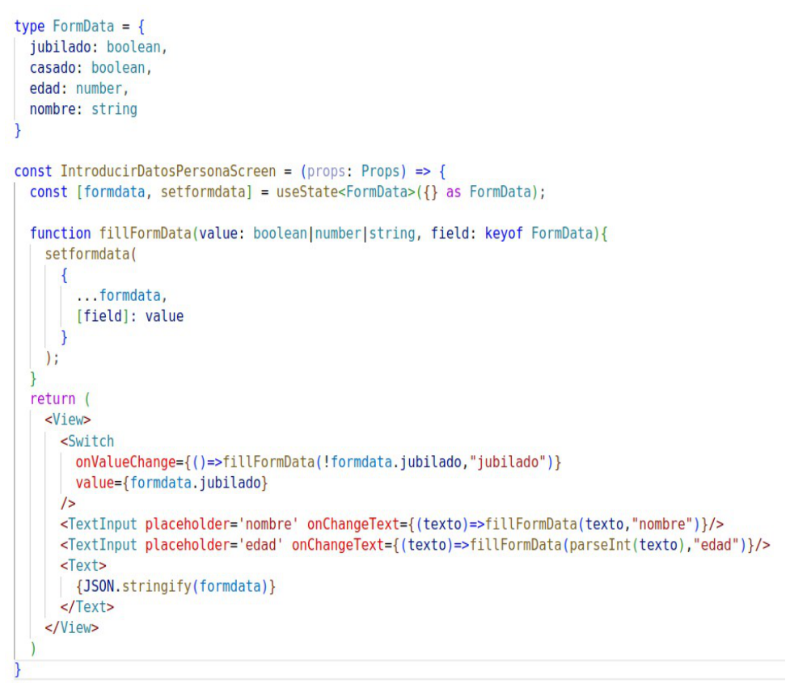

---


### Actualizar un campo del formulario

Podemos utilizar una función reutilizable con un nombre de campo tipado. `keyof DatosPersona` indica que únicamente se admitirán campos existentes en el formulario.

```tsx
function cambiarCampo<K extends keyof DatosPersona>(campo: K, valor: DatosPersona[K]) {
  setDatos(actual => ({ ...actual, [campo]: valor }));
}
// <TextInput value={datos.nombre} onChangeText={v => cambiarCampo('nombre', v)} />
// <Switch value={datos.jubilado} onValueChange={v => cambiarCampo('jubilado', v)} />
```

Al enviar el formulario, comprobad que el nombre no esté vacío y que la edad pueda convertirse en un número válido. Podéis mostrar los datos mediante una alerta o un resumen en pantalla.

### Práctica 15. Completar el formulario

Reproducid el ejemplo de persona (nombre, edad y jubilación) e **incorporad el `Switch` del campo `casado`**. Los cuatro campos deben actualizar correctamente el estado y mostrarse en un resumen final.

---


## Listas

React Native incluye `ScrollView`, `FlatList` y `SectionList`. `ScrollView` es útil con pocos elementos porque renderiza todo su contenido; **`FlatList` virtualiza listas largas**, representando preferentemente los elementos próximos a la zona visible. `SectionList` permite agruparlos por secciones.

### `FlatList`

Las propiedades fundamentales son `data`, `renderItem` y `keyExtractor`. Se pueden añadir `ListHeaderComponent`, `ItemSeparatorComponent` y `ListEmptyComponent`.

```tsx
import { FlatList, Text, View } from 'react-native';
const personas = [{ id: '1', nombre: 'Ana' }, { id: '2', nombre: 'Luis' }];
<FlatList
  data={personas}
  keyExtractor={item => item.id}
  renderItem={({ item, index }) => (
    <View style={{ padding: 12, backgroundColor: index % 2 ? '#eee' : '#fff' }}>
      <Text>{item.nombre}</Text>
    </View>
  )}
  ListHeaderComponent={<Text>Lista de personas</Text>}
/>
```

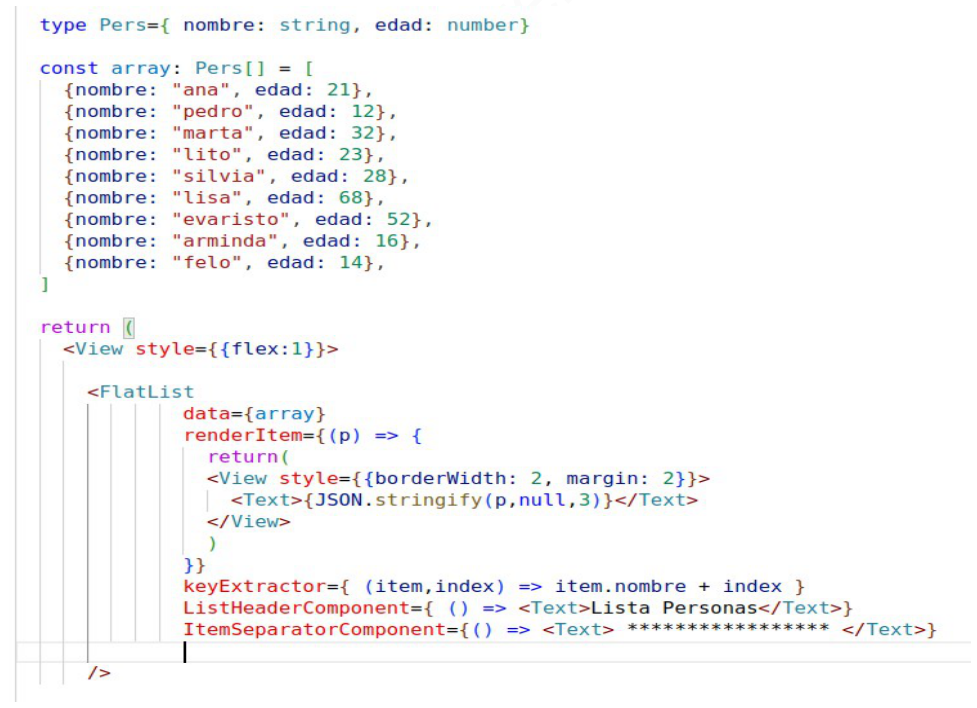

---


### Práctica 16. Lista de productos

Sustituid la lista de personas del ejemplo por una lista de productos. Cada elemento mostrará **nombre, precio y stock**. No añadáis separador entre elementos. Utilizad `index` dentro de `renderItem` para alternar el color de fondo entre posiciones pares e impares. La cabecera debe decir «Lista Productos», estar centrada y tener un tamaño mayor.

### Práctica 17. Tarjetas para calcular el IMC

Cread un componente `CardPersona.tsx` con los campos `id`, `nombre`, `altura` y `peso` y el cálculo del índice de masa corporal (IMC = peso en kg / altura en metros al cuadrado). La pantalla contenedora tendrá un botón «+» para añadir tarjetas y cada tarjeta dispondrá de un botón para eliminarla.

**Claves de implementación:** el contenedor mantiene un array de identificadores y crea las tarjetas con claves estables; cada tarjeta puede gestionar sus campos locales, mientras que la eliminación se comunica al componente padre mediante una función recibida por props. Validar las cifras evita dividir entre cero.

---


## Iconos

**Con Expo utilizaremos `@expo/vector-icons`**, que proporciona familias como Ionicons, MaterialIcons o FontAwesome sin modificar manualmente Gradle.

```tsx
import { Ionicons } from '@expo/vector-icons';
<Ionicons name="car-outline" size={40} color="blue" />
```

Consultad los nombres de iconos en https://icons.expo.fyi/ . El nombre debe existir en la familia elegida; los tipos de TypeScript ayudan a localizar errores de escritura.

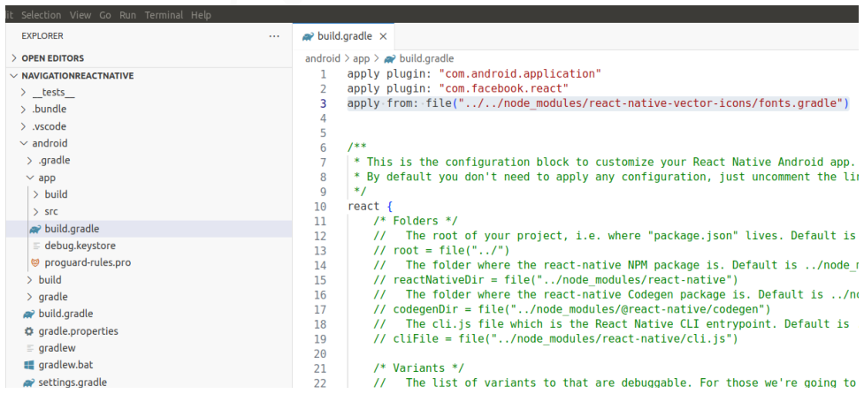

---


### Elegir la familia correcta de iconos

Cada familia tiene su propio catálogo. Por ejemplo, el icono `car-outline` pertenece a Ionicons y se importa desde `@expo/vector-icons/Ionicons` o como `{ Ionicons }` de `@expo/vector-icons`, según la forma que prefiráis. Las propiedades más habituales son `name`, `size` y `color`.

Las figuras ilustran el aspecto de los iconos, pero la **instalación de fuentes mediante Gradle no se realiza en Expo**. Aseguraos de que los iconos se representan tanto en la práctica como en el emulador.

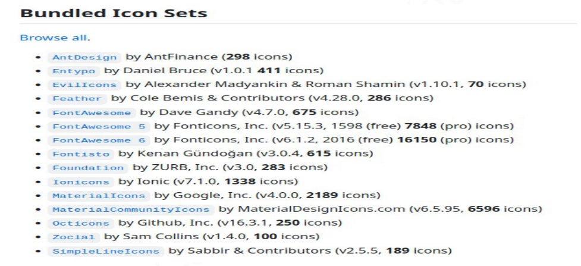

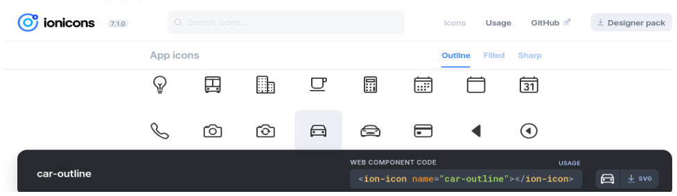

---


### Práctica 18. Diario de emociones

Cread una pantalla con `TextInput`, un botón y una zona donde mostrar las entradas del diario. Cada entrada contendrá el texto escrito, la fecha y la hora (incluidos los segundos) y un icono de emoción. Si el texto incluye `:-)`, mostrad un icono sonriente; si incluye `:-(`, un icono triste. Guardad las entradas en un array de estado para que no desaparezcan al añadir otra.

### Práctica 19. Insertar emoticonos en el texto

Cread otra pantalla con varios iconos de emociones encima de un `TextInput`. Al pulsar uno de los iconos, añadid la secuencia de texto correspondiente (por ejemplo, `:-)` o `:-(`) al final del contenido del campo. Utilizad `setTexto(actual => actual + ' :-)')` y mantened el campo controlado.

---


## Navegación en React Native

En aplicaciones móviles es habitual utilizar tres patrones: **Stack**, donde una pantalla abre otra y es posible volver; **Drawer**, un menú lateral; y **Tabs**, pestañas para cambiar entre apartados.

En nuestro proyecto Expo usaremos **Expo Router**, que incorpora navegación basada en archivos y permite definir estos tres patrones sin crear un `NavigationContainer` en `App.tsx`.

La ruta `src/app/practica01.tsx` corresponde a `/practica01`. Para navegar se utiliza `<Link href="/practica01">...</Link>` o `router.push('/practica01')`. Cuando una práctica necesite varias pantallas, añadiremos un directorio específico con archivos para cada ruta.

**Regla del dossier:** mantendréis `src/app/index.tsx` como índice de prácticas. Las navegaciones particulares no sustituirán el índice general ni modificarán las rutas de otros ejercicios.

---


### Estructura de navegación

Un ejemplo de rutas para un ejercicio de navegación Stack es:

```text
src/app/
├── _layout.tsx
├── index.tsx
└── stack/
    └── p20/
        ├── _layout.tsx
        ├── index.tsx
        └── detalle.tsx
```

`_layout.tsx` establece el navegador que comparten las pantallas de esa carpeta. En la raíz de la aplicación podemos utilizar un `Stack` que incluya el índice y las rutas de prácticas:

```tsx
// src/app/_layout.tsx
import { Stack } from 'expo-router';
export default function RootLayout() {
  return <Stack screenOptions={{ headerShown: false }} />;
}
```

No es necesario configurar manualmente `MainActivity.java`, el `AndroidManifest.xml` ni Gradle para mostrar estas pantallas en Expo Go.

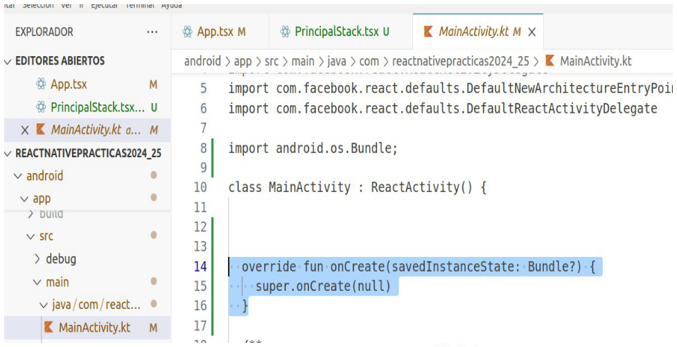

---


### Stack Navigation

Un navegador Stack mantiene una pila de pantallas. Cuando abrimos otra pantalla mediante `router.push`, esta se coloca encima de la anterior; con `router.back()` regresamos cuando existe una pantalla previa. Expo Router utiliza `Stack` para configurar este comportamiento.

```tsx
// src/app/stack/p20/_layout.tsx
import { Stack } from 'expo-router';
export default function Layout() {
  return <Stack><Stack.Screen name="index" options={{ title: 'Inicio' }} />
                <Stack.Screen name="detalle" options={{ title: 'Detalle' }} /></Stack>;
}
```

En `index.tsx` podéis utilizar `<Link href="/stack/p20/detalle">Ir a detalle</Link>`; en `detalle.tsx` mostrad un texto y utilizad `router.back()` para regresar. Los archivos forman parte del mismo proyecto Expo.

---


### Práctica 20. Primer Stack

Cread una aplicación de ejemplo con una pantalla **HomeScreen** que permita navegar a una segunda pantalla y regresar. Organizad ambas dentro de `src/app/stack/p20/` e incluid un enlace a `/stack/p20` desde el índice general de prácticas.

**Comprobad:** al abrir el ejercicio, la cabecera muestra el título elegido; al pulsar el control se abre la siguiente pantalla; la acción de volver regresa al origen. No debéis modificar `src/app/index.tsx` para convertirlo en HomeScreen.

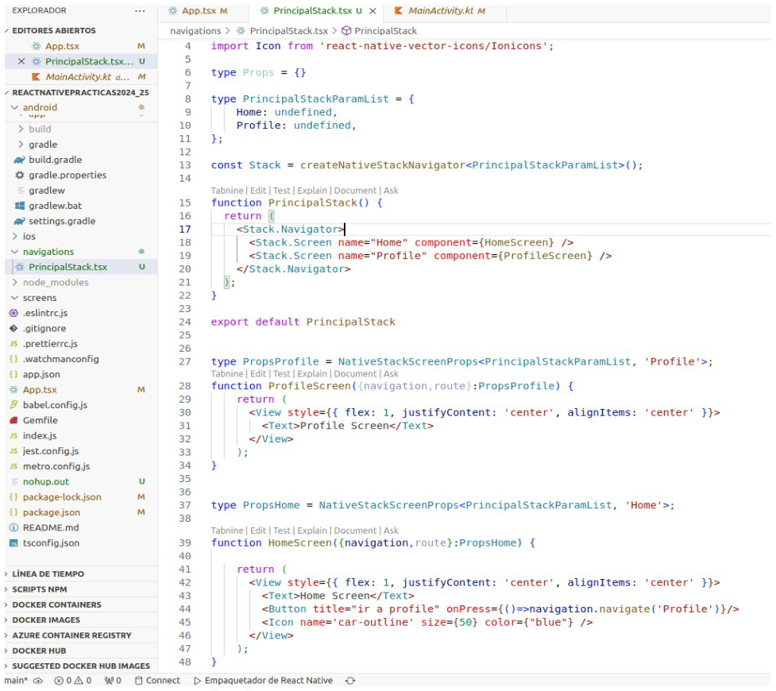

---


### Cambiar de pantalla y pasar parámetros

Con Expo Router utilizaremos `router.push` para navegar y podremos pasar parámetros mediante el objeto `params` o una ruta válida:

```tsx
import { router } from 'expo-router';
router.push({ pathname: '/stack/p21/tercera', params: { userName: 'Aquilino' } });
```

En la pantalla de destino recuperamos el dato mediante `useLocalSearchParams`:

```tsx
import { useLocalSearchParams } from 'expo-router';
const { userName } = useLocalSearchParams<{ userName?: string }>();
// <Text>Hola, {userName ?? 'invitado'}</Text>
```

Los parámetros de ruta se reciben como texto (o conjuntos de textos); si necesitáis números, convertidlos de manera explícita.

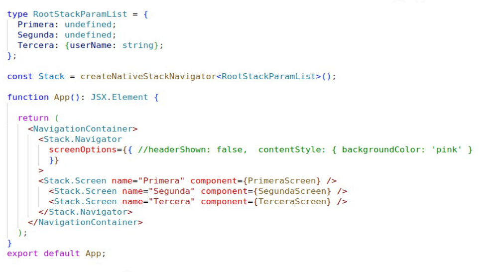

---


### Tipado de rutas y pantallas

TypeScript ayuda a detectar errores al nombrar rutas y parámetros. Expo Router genera tipos para las rutas del proyecto, . No es necesario definir un `RootStackParamList` manual para estas rutas.

Organizad el ejercicio en `src/app/stack/p21/` con tres archivos de pantalla (`index.tsx`, `segunda.tsx`, `tercera.tsx`) y un `_layout.tsx` de Stack. En la tercera pantalla deberá mostrarse el valor `userName` recibido.

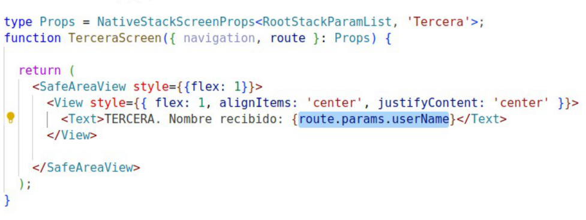

---


### Práctica 21. Stack con tres pantallas

Reproducid el ejemplo del documento con tres pantallas y controles para navegar entre ellas. Desde la primera, abrid la segunda y la tercera; al navegar a la tercera, enviad un nombre de usuario y mostradlo al recibirlo.

Utilizad `router.push()` y `useLocalSearchParams()` según se ha explicado. Comprobad también el botón de regreso de Android y la cabecera del navegador. Conservad el ejercicio anterior en su propia carpeta.

---


### Opciones de Stack Navigation

Las opciones de cabecera se configuran mediante `options` o `screenOptions` en `<Stack.Screen />`. Por ejemplo:

```tsx
<Stack.Screen name="index" options={{
  title: 'Mi nombre', headerTitleAlign: 'center',
  headerStyle: { backgroundColor: '#216c76' },
  headerTintColor: '#fff',
  headerBackVisible: false,
}} />
```

`headerBackVisible: false` oculta la representación habitual del botón de retroceso; **no desactiva necesariamente todos los gestos ni la navegación del sistema**. Para modificar el comportamiento completo hay opciones adicionales, pero no son necesarias para reproducir el ejercicio.

### Práctica 22. Personalizar la cabecera

Cread un Stack de dos pantallas, cambiad el color de fondo de la cabecera, mostrad el título en blanco y centrado, utilizad vuestro nombre como título y ocultad el botón visual de regreso. Comparad el comportamiento al volver con los gestos de Android.

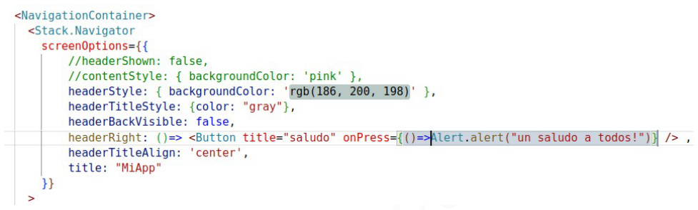

---


## Contexto con React Native y navegación

`Context` permite compartir información entre componentes sin pasarla por todas las capas mediante props. Un proveedor envuelve las pantallas que necesitan acceder a ese estado; en Expo Router puede situarse dentro del `_layout.tsx` del ejercicio.

```tsx
import { createContext, useContext, useState } from 'react';
type Tarea = { id: number; texto: string; completada: boolean };
type TareasContexto = { tareas: Tarea[]; setTareas: React.Dispatch<React.SetStateAction<Tarea[]>> };
const TareasContext = createContext<TareasContexto | null>(null);
export function useTareas() {
  const valor = useContext(TareasContext);
  if (!valor) throw new Error('Falta el proveedor de tareas');
  return valor;
}
```

El proveedor tendrá el `useState` del listado, para que los cambios realizados desde una pantalla puedan verse en otra.

### Práctica 23. Lista de tareas

Construid dos pantallas: listado (`FlatList`) y edición/creación. Debe ser posible **añadir, marcar como completada, editar y eliminar** tareas. Representad las tareas completadas con texto tachado e icono diferente. Generad identificadores y compartid el estado a través de un Context, sin perderlo al navegar entre las dos pantallas.

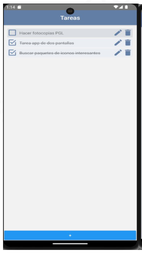

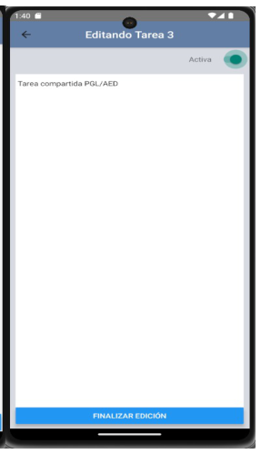

---


## Drawer Navigation

Un navegador Drawer muestra un menú lateral. Para trabajar con Expo Router utilizaremos el navegador Drawer compatible con el SDK del proyecto. **Antes de instalar dependencias, consultad la documentación de la versión que estéis utilizando:** https://docs.expo.dev/router/advanced/drawer/ .

En versiones actuales de Expo Router, la instalación en Android requiere normalmente las bibliotecas de animación y gestos compatibles:

```bash
npx expo install react-native-reanimated react-native-worklets react-native-gesture-handler
```

No instaléis bibliotecas que requieran cambios manuales en Gradle para estas prácticas. Si vuestra versión indica un procedimiento distinto, seguid la documentación de esa versión.

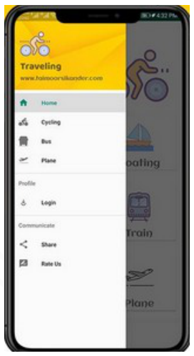

---


### Layout Drawer en Expo Router

Una carpeta con un `_layout.tsx` propio puede definir sus opciones de menú:

```tsx
// src/app/drawer/p24/_layout.tsx
import { Drawer } from 'expo-router/drawer';
export default function Layout() {
  return (
    <Drawer>
      <Drawer.Screen name="index" options={{ title: 'Inicio', drawerLabel: 'Inicio' }} />
      <Drawer.Screen name="about" options={{ title: 'Acerca de', drawerLabel: 'Acerca de' }} />
    </Drawer>
  );
}
```

Los archivos `index.tsx` y `about.tsx` deben existir dentro de esa carpeta. El Drawer del ejercicio se abre desde el índice principal mediante un enlace a `/drawer/p24`.

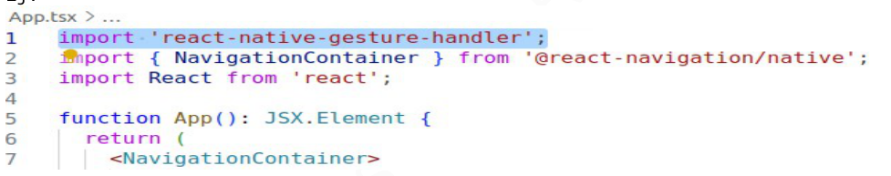

---


### Combinar Drawer con Stack

Un elemento del Drawer puede abrir un conjunto de pantallas gestionadas por Stack. Para mantener separados los patrones, cread subcarpetas con sus propios layouts. Así el menú lateral y la navegación hacia pantallas de detalle pueden coexistir.

### Práctica 24. Drawer con tareas y «About»

Implementad lo siguiente: el Drawer tendrá una opción para acceder a un Stack con la pantalla de tareas y sus detalles, y otra opción **AboutScreen** con información personal (nombre, curso, etc.). Podéis reutilizar el contexto y la interfaz de la práctica 23 sin eliminar aquella práctica.

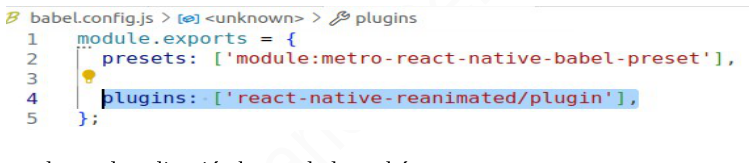

---


### Opciones de Drawer Navigation

Las opciones de `Drawer` se configuran con `screenOptions` y `options`. Podéis modificar el ancho, el fondo, la cabecera, el texto de las opciones y el elemento seleccionado.

```tsx
<Drawer screenOptions={{
  drawerStyle: { width: 250, backgroundColor: '#f3f8f7' },
  drawerActiveTintColor: '#0b776a',
  headerTintColor: '#fff',
  headerStyle: { backgroundColor: '#0b776a' },
}} />
```

Consultad los nombres de las propiedades en la documentación actual de React Navigation cuando necesitéis personalizaciones no mostradas aquí.

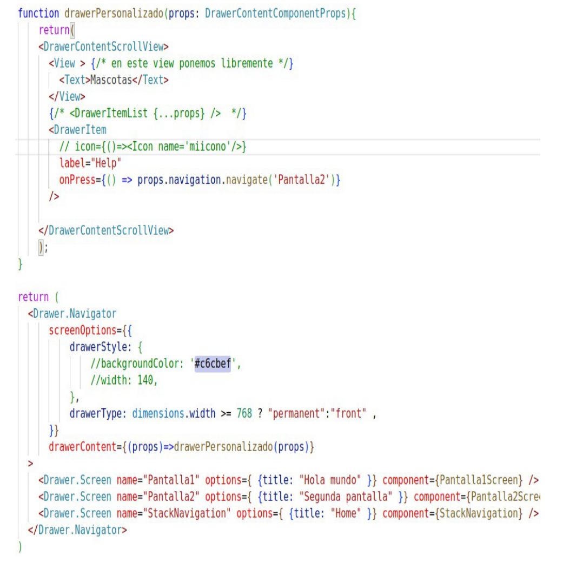

---


### Práctica 25. Personalización y orientación del Drawer

Reproducid el ejemplo anterior y **girad el emulador de Android Studio** para comprobar si el menú permanece visible al cambiar la orientación. Modificad el color de fondo del menú lateral y configurad una anchura de **200** mediante `drawerStyle: { width: 200 }`.

Explorad también la opción `drawerContent`: personalizad su contenido y comparad el comportamiento del menú con y sin esa propiedad. Si creáis vuestro propio contenido, debéis incluir enlaces funcionales a las pantallas (podéis utilizar `DrawerItemList` y las propiedades recibidas por `drawerContent`). **Observad y explicad** qué ocurre con los enlaces cuando el contenido predeterminado se sustituye por uno personalizado.

Guardad esta versión sin eliminar la práctica 24. En el README incorporad capturas en vertical y horizontal.

---


### Práctica 26. Aplicación de mascotas

Reproducid el ejercicio de mascotas utilizando Drawer y una lista. La pantalla de listado mostrará mascotas; al pulsar una, se abrirá su ficha de detalle con los datos correspondientes. Organizar las rutas de detalle mediante identificadores evita crear un archivo distinto por cada mascota.

Podéis crear `src/app/drawer/p26/` para esta práctica y aprovechar componentes `MascotaCard` o `MascotaDetalle` definidos en `src/components/`. El ejercicio debe permanecer accesible desde el índice general.

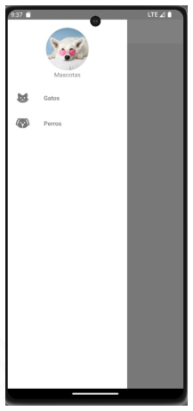

---


## Tab Navigation

Las pestañas permiten cambiar entre pantallas principales sin tener que volver constantemente a un menú anterior. Con Expo Router se define un layout `Tabs` en la carpeta de rutas del ejercicio:

```tsx
import { Tabs } from 'expo-router';
export default function Layout() {
  return <Tabs>
    <Tabs.Screen name="index" options={{ title: 'Inicio' }} />
    <Tabs.Screen name="perfil" options={{ title: 'Perfil' }} />
  </Tabs>;
}
```

Cada nombre se corresponde con un archivo existente, `index.tsx` y `perfil.tsx`. Podéis añadir iconos a las pestañas mediante `tabBarIcon` y `@expo/vector-icons`.

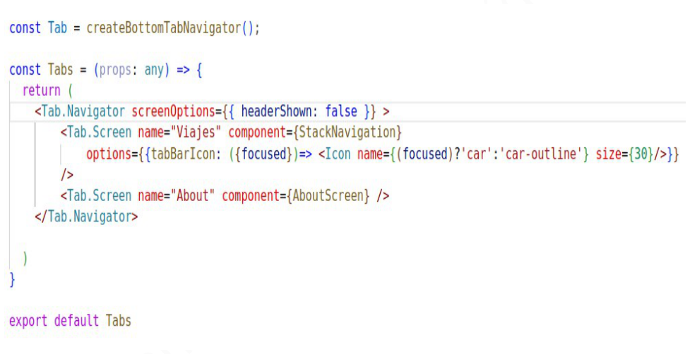

---


### Práctica 27. Tabs combinadas con Stack

Implementad una combinación de pestañas y navegación Stack. Al pulsar una pestaña se abrirá su sección; desde una pantalla de la sección podréis entrar en un detalle y volver sin modificar el resto de pestañas.

Organizad el conjunto dentro de una carpeta del propio ejercicio (por ejemplo, `src/app/tabs/p27/`), utilizando layouts anidados cuando sea necesario.

## Accediendo a APIs

Una API web permite solicitar datos a un servidor. En React Native con Expo utilizamos `fetch` con `async/await`; normalmente convertimos la respuesta a JSON. Comprobad `response.ok` y tratad los errores:

```tsx
async function cargarPokemon() {
  const respuesta = await fetch('https://pokeapi.co/api/v2/pokemon/pikachu');
  if (!respuesta.ok) throw new Error('No se pudieron obtener los datos');
  const pokemon = await respuesta.json();
  return pokemon;
}
```

Una petición debe mostrar estados de carga, error y resultado. Para representar listas extensas es adecuado `FlatList`.

---


### Práctica 28. Aplicación Pokémon

Desarrollad una aplicación Pokémon utilizando datos de **PokeAPI**. Mostrad una lista de Pokémon con su nombre y, cuando sea posible, imagen; al seleccionar uno, mostrad una pantalla de detalle con información obtenida de la API. La pantalla debe manejar los estados de carga, ausencia de resultados y error de conexión.

**Sugerencia de organización:** `src/api/pokemon.ts` para funciones HTTP, un componente de tarjeta reutilizable y las pantallas de lista y detalle dentro de una carpeta de rutas de la práctica 28. No es necesario instalar Axios: `fetch` ya está disponible.

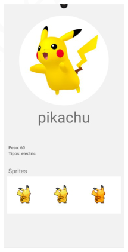

---


## Permisos

Las aplicaciones móviles deben solicitar autorización para determinadas funciones del dispositivo. Expo proporciona bibliotecas específicas, por ejemplo `expo-location` para geolocalización.

```bash
npx expo install expo-location
```

En Android la aplicación puede consultar el permiso en tiempo de ejecución. El usuario puede aceptarlo o rechazarlo; el código debe manejar ambos resultados. No pidáis permisos innecesarios antes de que la funcionalidad se utilice.

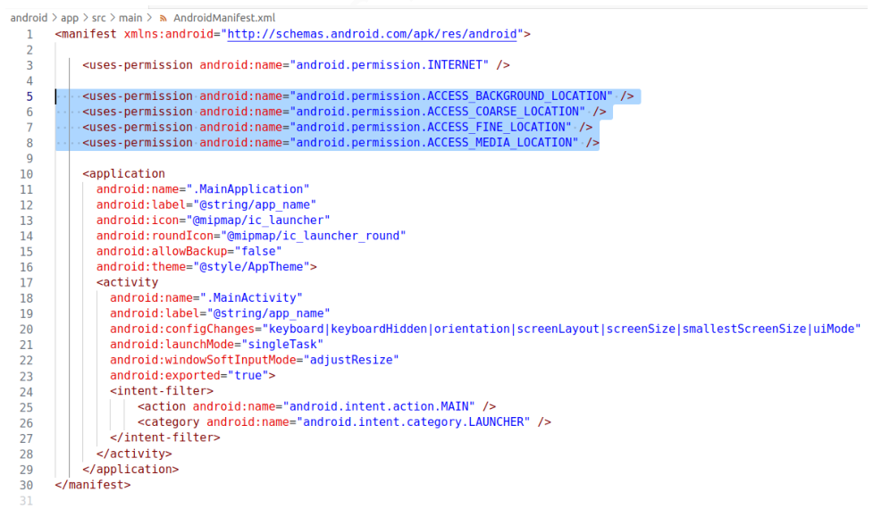

---


### Solicitar la ubicación actual

```tsx
import * as Location from 'expo-location';

async function leerUbicacion() {
  const permiso = await Location.requestForegroundPermissionsAsync();
  if (permiso.status !== 'granted') return null;
  return await Location.getCurrentPositionAsync({});
}
```

La respuesta incluye coordenadas en `coords.latitude` y `coords.longitude`. El permiso en primer plano es suficiente para el ejercicio; **no necesitamos ubicación permanente en segundo plano**. Añadid un mensaje comprensible cuando el usuario rechace el permiso.

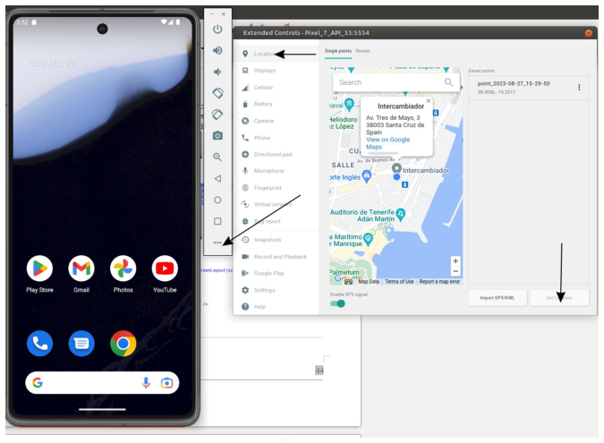

---


### Ubicación simulada con Android Studio

El emulador permite probar el comportamiento sin desplazarse físicamente. Desde los controles ampliados del emulador, en el apartado de ubicación, podéis definir una posición simulada.

### Práctica 29. Localización del dispositivo

Cread una pantalla con un botón para solicitar el permiso de ubicación y otro para obtener las coordenadas actuales. Mostrad latitud y longitud en pantalla. Si el permiso se rechaza, informad al usuario; si el dispositivo no puede obtener la posición, mostrad un error. Comprobad el ejercicio con la posición simulada de Android Studio.

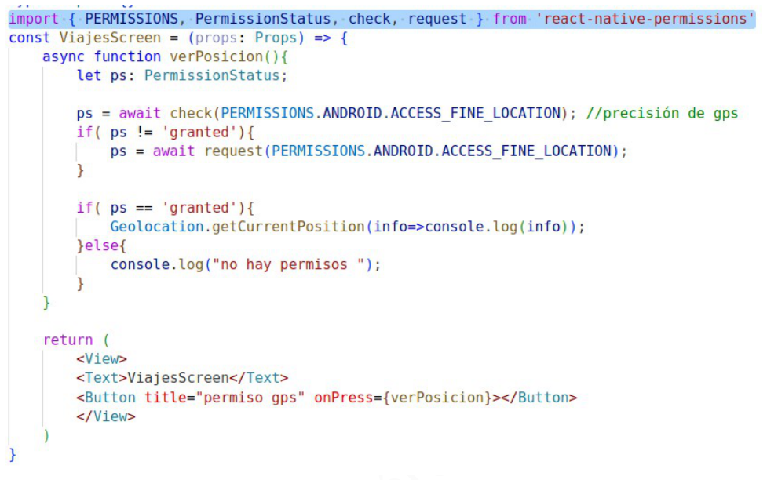

---


## Async Storage y WebView

**AsyncStorage** permite almacenar pares clave/valor de forma persistente entre ejecuciones. No es una base de datos relacional ni está concebido para guardar secretos. Lo instalamos con:

```bash
npx expo install @react-native-async-storage/async-storage
```

```tsx
import AsyncStorage from '@react-native-async-storage/async-storage';
await AsyncStorage.setItem('usuario', JSON.stringify({ nombre: 'Ana' }));
const texto = await AsyncStorage.getItem('usuario');
const usuario = texto ? JSON.parse(texto) : null;
```

Como `getItem` y `setItem` son asíncronos, utilizad `await` y controlad posibles errores. Para objetos, convertid a JSON con `JSON.stringify` y recuperad con `JSON.parse`.

### Práctica 30. Historial de ubicaciones

**Ampliad la práctica 29** (permisos y localización). El botón de obtener ubicación deberá solicitar el permiso cuando sea necesario y guardar en AsyncStorage **latitud, longitud y timestamp**. Mostrad en un `Text` un mensaje que confirme qué posición se ha guardado.

Añadid otro botón llamado **«Historial»**. Al pulsarlo, leed el array completo de posiciones almacenadas en AsyncStorage y mostradlo en pantalla. Recuperad el array existente con `getItem`, convertidlo con `JSON.parse`, añadid una nueva posición y guardad de nuevo la lista con `setItem`. No sustituyáis todo el historial por la última ubicación.

**Comprobación:** guardad al menos dos posiciones simuladas desde Android Studio, cerrad y volved a abrir la aplicación, y comprobad que ambas continúan apareciendo en el historial.

---


### WebView

`WebView` permite mostrar contenido web dentro de una pantalla nativa. En Expo se instala mediante:

```bash
npx expo install react-native-webview
```

```tsx
import { WebView } from 'react-native-webview';
export default function PaginaWebScreen() {
  return <WebView source={{ uri: 'https://reactnative.dev/' }} style={{ flex: 1 }} />;
}
```

Para mostrar HTML local puede emplearse `source={{ html: '<h1>Hola</h1>' }}`. Si obtenéis una fuente RSS o Atom, recordad que es XML: hay que **obtenerla y procesarla** antes de mostrar una lista de noticias. Una WebView no convierte automáticamente el XML en tarjetas.

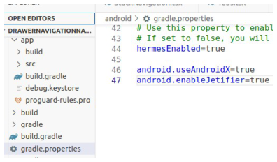

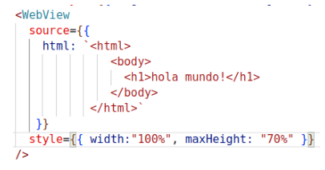

---


### Práctica 31. Contenido web y noticias

Reproducid el ejercicio del dossier relacionado con WebView y noticias RSS. Cargad una página web en una pantalla y, para la parte RSS, obtened una fuente válida, procesad sus elementos y mostrad títulos y enlaces en una lista. Al pulsar una noticia podéis mostrar su página utilizando WebView.

Si la fuente RSS elegida no responde o bloquea las peticiones, elegid otra fuente RSS pública e indicadlo en el README. Para transformar XML en objetos JavaScript podéis utilizar una biblioteca compatible con Expo, instalada según la documentación de su versión.

## Bases de datos: SQLite y TypeORM

Para realizar las prácticas de bases de datos utilizaremos **`expo-sqlite` y SQL**, compatibles con el proyecto Expo. Trabajaremos con tablas, operaciones CRUD, claves externas, relaciones y transacciones.

---


### Preparación de SQLite en Expo

```bash
npx expo install expo-sqlite
```

SQLite guarda tablas y registros de manera local. Crearemos la base al iniciar la aplicación o al entrar en el primer ejercicio de persistencia. Usad nombres de tablas distintos para los bloques de personas, tienda y propietarios/casas.

```tsx
import * as SQLite from 'expo-sqlite';
const db = await SQLite.openDatabaseAsync('dossier.db');
await db.execAsync(`
  PRAGMA foreign_keys = ON;
  CREATE TABLE IF NOT EXISTS personas (
    id INTEGER PRIMARY KEY AUTOINCREMENT,
    nombre TEXT NOT NULL
  );
`);
```

`execAsync` resulta útil para sentencias SQL estáticas de preparación. **Los datos del usuario deben incluirse con parámetros en `runAsync`, `getFirstAsync` o `getAllAsync`**, no concatenando cadenas SQL.

---


### Crear registros con SQLite

`runAsync` ejecuta operaciones como `INSERT`, `UPDATE` y `DELETE`. Podemos recuperar el último identificador insertado desde el resultado:

```tsx
const resultado = await db.runAsync(
  'INSERT INTO personas (nombre) VALUES (?)', 'Alicia'
);
console.log(resultado.lastInsertRowId);
```

El equivalente de crear y guardar una entidad de TypeORM es construir el registro mediante una sentencia `INSERT` y sus parámetros. El código de persistencia debería ubicarse en `src/db/` para separarlo de la pantalla.

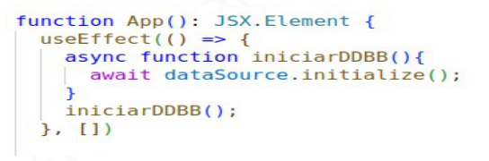

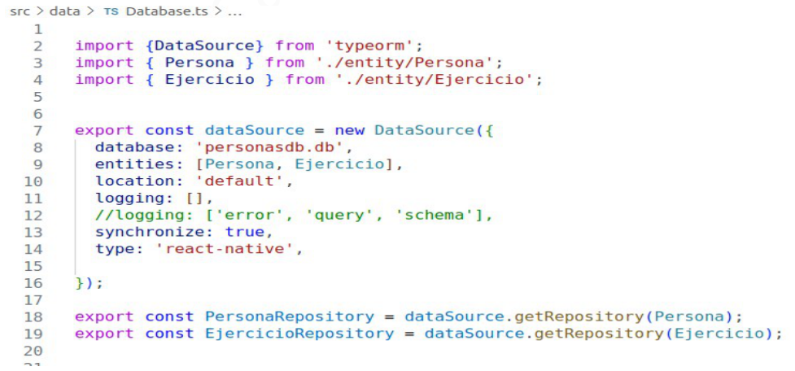

---


### Consultar y mostrar registros

`getAllAsync` devuelve todos los registros de una consulta y `getFirstAsync` devuelve el primero o `null`. Las respuestas pueden tiparse con TypeScript:

```tsx
type Persona = { id: number; nombre: string };
const personas = await db.getAllAsync<Persona>('SELECT id, nombre FROM personas ORDER BY id');
```

Mostrad los datos con `FlatList` y utilizad el identificador como `keyExtractor`. Después de guardar un registro, volved a consultar la base o actualizad el estado local para reflejar el cambio.

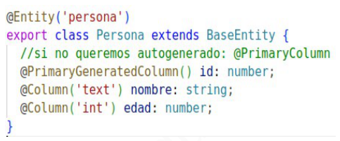

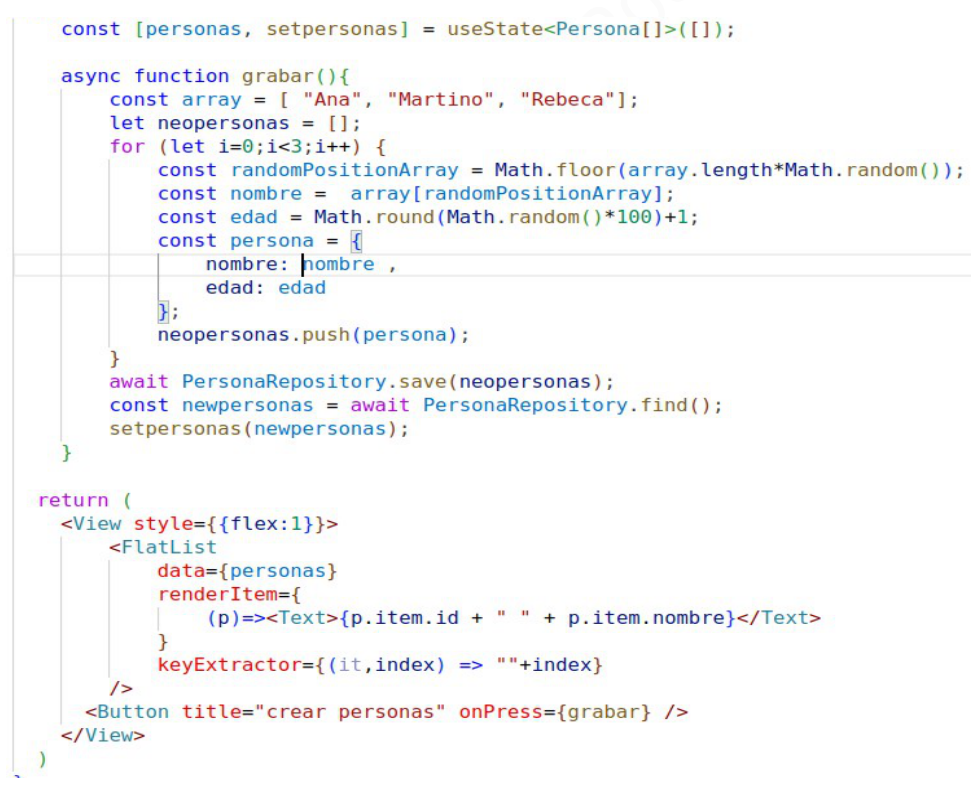

---


### Práctica 32. Guardar personas

Implementad el alta de personas. Preparad la tabla, cread un formulario y almacenad los registros con `runAsync`. Comprobad que aparecen en la base de datos y que no se duplican tablas al volver a entrar en la pantalla.

### Práctica 33. Recuperar personas

Ampliad el trabajo anterior para recuperar y listar los registros guardados. Utilizad `getAllAsync`, `FlatList` y una función de actualización tras insertar nuevos datos. Ambas prácticas deberán seguir siendo accesibles desde el índice general.

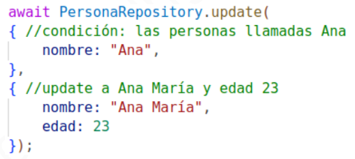

---


### Búsquedas: equivalencia con `find`

El método `find` de TypeORM se sustituye por una consulta `SELECT`. Para buscar una única fila por identificador:

```tsx
const persona = await db.getFirstAsync<{ id: number; nombre: string }>(
  'SELECT id, nombre FROM personas WHERE id = ?', 1
);
```

Con `WHERE` filtramos; con `ORDER BY` ordenamos; y con `LIMIT` restringimos el número de resultados. Utilizad **parámetros** para valores de búsqueda como nombres o precios. Los nombres de columnas y el sentido de ordenación deben elegirse a partir de opciones controladas por el programa, no interpolarse directamente desde un `TextInput`.

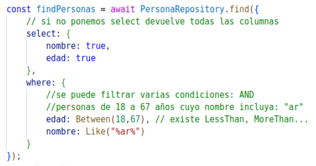

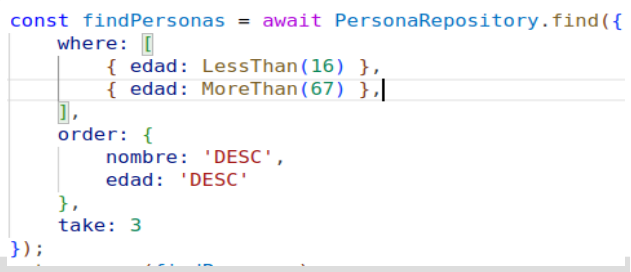

---


### Entidades, columnas y tipos de datos

En TypeORM se describen entidades mediante decoradores. En Expo SQLite creamos tablas SQL con sus columnas y restricciones. Tipos comunes: `INTEGER`, `REAL`, `TEXT` y `BLOB`. Los booleanos se representan habitualmente como `0` y `1`.

```sql
CREATE TABLE IF NOT EXISTS productos (
  id INTEGER PRIMARY KEY AUTOINCREMENT,
  nombre TEXT NOT NULL,
  precio REAL NOT NULL,
  stock INTEGER NOT NULL DEFAULT 0,
  descontinuado INTEGER NOT NULL DEFAULT 0
);
```

### Práctica 34. Tienda de productos

Cread una aplicación de tienda dentro del ejercicio con pestañas: en una pestaña se introducen productos alimentarios (`nombre`, `precio`, `stock` y `descontinuado`); en la otra se consulta la lista aplicando filtros de subcadena del nombre, precio mínimo y máximo, y un `Switch` para ordenar por nombre de forma ascendente. Guardad los productos en SQLite y consultadlos con `SELECT` parametrizados.

---


## Relaciones

### Relación 1:N y N:1

Una categoría puede tener muchos productos, pero un producto pertenece a una categoría. En SQL se representa guardando el identificador de la categoría en cada producto:

```sql
CREATE TABLE IF NOT EXISTS categorias (
  id INTEGER PRIMARY KEY AUTOINCREMENT,
  nombre TEXT NOT NULL UNIQUE
);
-- Si la tabla productos se crea desde cero, añadid:
-- categoria_id INTEGER REFERENCES categorias(id)
```

**Atención:** si ya creasteis `productos` en la práctica 34, no la eliminéis para continuar: incorporad `categoria_id` mediante una migración controlada (`ALTER TABLE` cuando proceda) o preparad la estructura definitiva antes de comenzar estas prácticas. Activad `PRAGMA foreign_keys = ON` en la conexión.

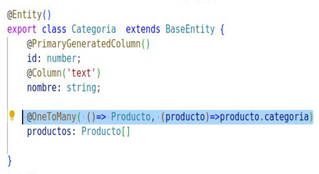

---


### Guardar relaciones 1:N

En un formulario de producto, mostrad un selector con categorías almacenadas y guardad el identificador elegido en `productos.categoria_id`. Al recuperar productos, un `JOIN` puede obtener también el nombre de la categoría.

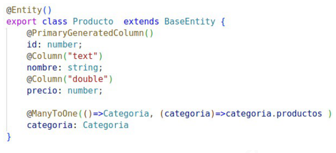

### Práctica 35. Crear categorías

Ampliad la tienda añadiendo una pestaña para registrar categorías. Guardadlas en la tabla `categorias` y comprobad que se pueden recuperar.

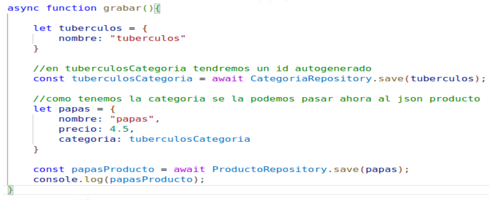

### Práctica 36. Asignar categorías a productos

Modificad el formulario de creación de productos para seleccionar una categoría existente y almacenar su referencia. Comprobad que el producto queda asociado correctamente. Mantened las pestañas y funciones de la práctica 34.

---


### Consultar categorías con sus productos

Podéis recuperar una categoría y los productos asociados con una sentencia de este tipo:

```sql
SELECT p.id, p.nombre, p.precio, c.nombre AS categoria
FROM productos AS p
JOIN categorias AS c ON c.id = p.categoria_id
ORDER BY c.nombre, p.nombre;
```

### Práctica 37. Mostrar las categorías

Añadid una pestaña que presente todas las categorías en una `FlatList`. Debajo de cada una, mostrad los productos relacionados; para comprobar los datos durante el desarrollo, podéis utilizar `JSON.stringify()` para representar temporalmente sus datos. No cambiéis el diseño de los formularios anteriores para resolver esta práctica.

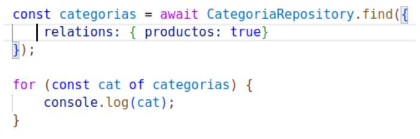

---


### Relaciones N:M (equivalencia con `@ManyToMany`)

Una persona propietaria puede tener varias casas y una casa puede pertenecer a varias personas. En SQLite se necesita una tabla intermedia con las claves de ambas entidades:

```sql
CREATE TABLE IF NOT EXISTS propietarios (
  id INTEGER PRIMARY KEY AUTOINCREMENT,
  nombre TEXT NOT NULL
);
CREATE TABLE IF NOT EXISTS casas (
  referencia_catastral TEXT PRIMARY KEY,
  direccion TEXT NOT NULL
);
CREATE TABLE IF NOT EXISTS propietarios_casas (
  propietario_id INTEGER NOT NULL,
  casa_ref TEXT NOT NULL,
  PRIMARY KEY (propietario_id, casa_ref),
  FOREIGN KEY (propietario_id) REFERENCES propietarios(id),
  FOREIGN KEY (casa_ref) REFERENCES casas(referencia_catastral)
);
```

La clave primaria compuesta evita guardar dos veces una misma asociación.

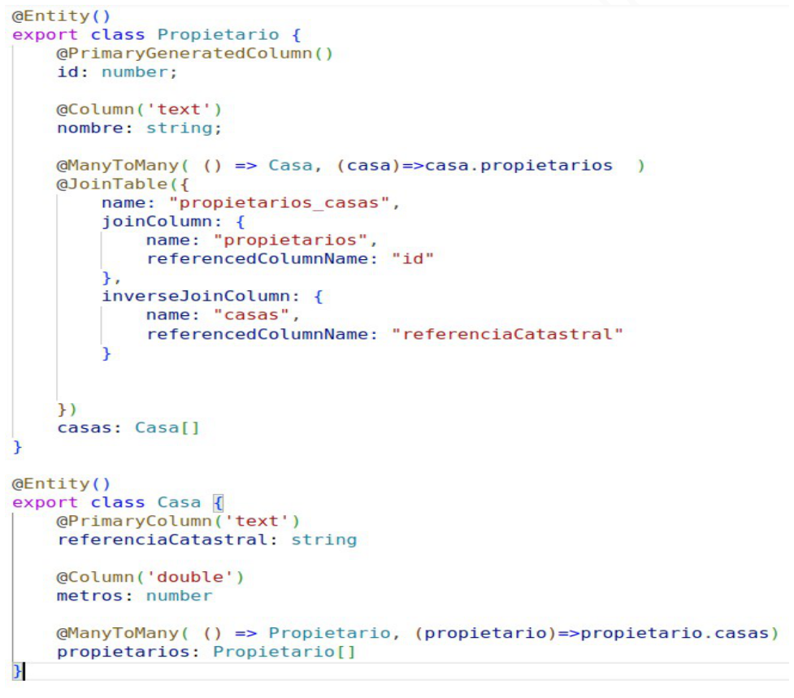

---


### ¿Cómo se utiliza una tabla intermedia?

Primero creamos personas propietarias y casas. Después relacionamos ambas insertando una fila con `propietario_id` y `casa_ref`. No guardamos una lista de casas dentro de una única celda de propietarios: cada asociación es una fila independiente.

```tsx
await db.runAsync(
  'INSERT INTO propietarios_casas (propietario_id, casa_ref) VALUES (?, ?)',
  propietarioId, referencia
);
```

Al utilizar claves externas, insertad primero los registros referenciados. Si una relación no existe, la aplicación debe ofrecer un mensaje adecuado y no guardar datos inválidos.

---


### Recuperar una relación N:M

Para obtener las casas asociadas a una persona propietaria se utiliza una consulta `JOIN`:

```sql
SELECT c.*
FROM casas AS c
JOIN propietarios_casas AS pc
  ON pc.casa_ref = c.referencia_catastral
WHERE pc.propietario_id = ?;
```

Podéis integrar esta consulta en una función `obtenerCasasDePropietario(id: number)`. Devolved un array de objetos tipados para que la pantalla los muestre sin incluir sentencias SQL dentro del JSX.

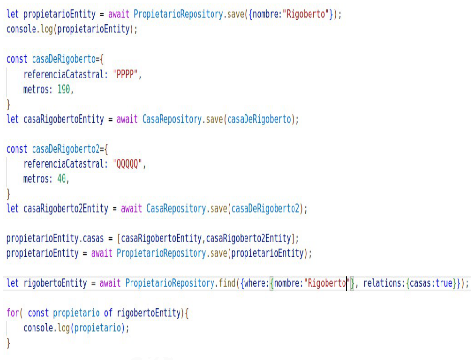

---


### Práctica 38. Propietarios y casas

Reproducid el ejercicio del dossier con pestañas para dar de alta personas propietarias, registrar casas y establecer asociaciones entre ambos. Añadid una lista de propietarios con sus casas, mostrando la información relacionada mediante `FlatList` y `JSON.stringify()` o una presentación equivalente. Todas las acciones deben guardarse en SQLite.

### Práctica 39. Eliminar asociaciones

Añadid una pestaña con un campo para el identificador de propietario y otro para la referencia catastral de la casa. Al pulsar el botón de eliminación, borrad **solo la fila correspondiente de `propietarios_casas`**, sin borrar los datos de las entidades principales.

```tsx
await db.runAsync(
  'DELETE FROM propietarios_casas WHERE propietario_id = ? AND casa_ref = ?',
  propietarioId, referencia
);
```

Comprobad que las demás asociaciones permanecen intactas.

---


## Transacciones

Una transacción agrupa varias operaciones sobre la base de datos. Si una de ellas falla, deben revertirse todas para que no quede información guardada a medias.

Para las operaciones de escritura relacionadas, Expo SQLite dispone de `withExclusiveTransactionAsync`, que proporciona un objeto `tx` para ejecutar todas las sentencias de la transacción:

```tsx
await db.withExclusiveTransactionAsync(async tx => {
  for (const casa of casas) {
    await tx.runAsync(
      'INSERT INTO casas (referencia_catastral, direccion) VALUES (?, ?)',
      casa.referencia_catastral, casa.direccion
    );
  }
});
```

Si se produce un error durante el bucle, la transacción no se confirma. Comprobad cómo se manejan los registros repetidos (clave primaria) para mostrar al usuario un mensaje claro.

### Práctica 40. Guardado transaccional

Partiendo del ejercicio de propietarios y casas, implementad una función de acceso a datos denominada **`saveAtOnce(casas: Casa[])`**. Debe guardar un array de casas en una única transacción: o se guardan todas, o no se guarda ninguna. Preparad un caso correcto y otro que produzca un error controlado; verificad después el estado de la base de datos.

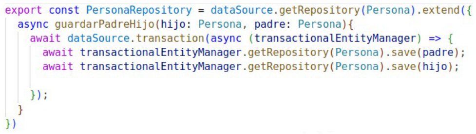

---

## Comprobación final y entrega del dossier

Antes de la entrega definitiva, abrid el proyecto en el emulador de Android Studio y comprobad, desde el índice de prácticas, que los resultados anteriores siguen siendo accesibles. Revisad los errores de consola, la navegación, los formularios, los permisos y la persistencia de las bases de datos. Si una funcionalidad depende de una conexión o permiso, indicadlo en el `README.md`.

**Repositorio único:** entregad el enlace al repositorio actualizado, junto con la documentación de todas las prácticas. Las entregas parciales, los commits descriptivos con fecha y el plazo definitivo son los publicados en el Aula Virtual.

## Documentación oficial de consulta

- [Expo: crear un proyecto](https://docs.expo.dev/get-started/create-a-project/)
- [Expo: configurar el entorno Android](https://docs.expo.dev/get-started/set-up-your-environment/)
- [Expo Router](https://docs.expo.dev/router/introduction/)
- [Expo Router: Drawer](https://docs.expo.dev/router/advanced/drawer/)
- [Expo SQLite](https://docs.expo.dev/versions/latest/sdk/sqlite/)
- [React Native: componentes y estilos](https://reactnative.dev/docs/components-and-apis)
